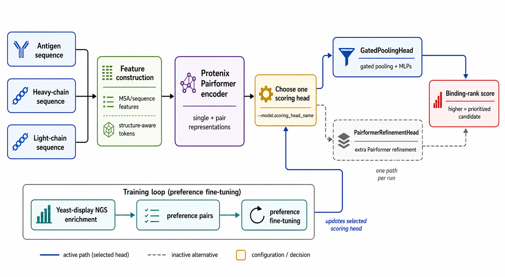

# AbAffMat（抗体亲和力成熟）复现实验

AbAffMat 旨在成为 AurekaBio 的 Aurabind 架构在 *in silico*（计算机模拟）抗体亲和力成熟方面的开源复现与扩展。

原始的 Aurabind 推理框架获取自 [github.com/AurekaBio/Aureka-AIntibody-Challenges](https://github.com/AurekaBio/Aureka-AIntibody-Challenges)。AurekaBio 是 2025 年 AIntibody 挑战赛（[官网](https://www.aintibody.org/the-challenges/)、[论文](https://www.nature.com/articles/s41587-024-02469-9)）的参与者之一。（GitHub 上其他引用 "AIntibody" 的内容见[此处](https://github.com/search?q=AIntibody&type=code)。）

Aurabind 使用 [Protenix](https://www.biorxiv.org/content/10.64898/2026.02.05.703733v3) 中的 Pairformer 模块作为编码主干，用于生成蛋白质-蛋白质相互作用（此处为抗体-抗原复合物）的结构与序列感知表示，然后通过一个打分头（scoring head）将这些表示压缩为单一的亲和力排序分数。
原始的 Aurabind 代码包含两个打分头：一个带轻量 MLP 的门控池化头（现为 `GatedPoolingHead`，此前为 `AffinityHead`）和一个带有额外 Pairformer 精炼模块的头（现为 `PairformerRefinementHead`，此前为 `BinderHead`）。

## 模型架构



AbAffMat 根据抗原、重链和轻链序列对抗体-抗原复合物进行打分。酵母展示（yeast-display）NGS 富集数据被转换为偏好对（preference pairs），用于打分头的微调。

[AIntibody 挑战赛 1](https://www.aintibody.org/the-challenges/) 是一项 *in silico* 抗体亲和力成熟任务，旨在基于亲和力成熟分选输出的 NGS 数据集，设计出对 SARS-CoV-2 RBD 具有更高亲和力且具有良好可开发性的抗体 CDR。该数据集的多样性覆盖 LCDR1-2、LCDR3 和 HCDR1-2，如 [Teixeira 等人 2022](https://www.aintibody.org/wp-content/uploads/2024/10/Simultaneous-affinity-maturation-and-developability-enhancement-using-natural-liability-free-CDRs.pdf) 所述。

此处使用的 AIntibody 挑战赛 1 数据 CSV 获取自 [github.com/alexstj0hn/AIntibody](https://github.com/alexstj0hn/AIntibody/blob/main/data/AIntibody_COMPETITION_1.csv)。
这不是 AIntibody 挑战赛的官方数据源，并且该 CSV 尚未与挑战赛结果公布时预期提供的官方竞赛数据进行核对验证。在完成该比对之前，请将这些数据以及由此衍生的任何检查点（checkpoint）或基准（benchmark）视为临时性（provisional）数据。
分选群体中配对的轻重链序列的冗余度近似反映了选择后的富集程度，预期与抗原（此处为 SARS-CoV-2 RBD）的亲和力相关，尽管这种相关性存在噪声。

相对于原始 Aurabind 代码库的主要改动包括：

- 新增本地及 Colab 就绪的推理流程，用于对抗体/抗原复合物打分，包括 `prepare_scoring_inputs.py`、`score_candidates.sh` 以及 `runners/score_complex.py` 打分运行器。
- 新增酵母展示数据的预处理与规范化，支持混合 IMGT/Kabat CDR 处理、亲本序列推断、突变审计、可恢复检查点、生成的 JSON 打分输入，以及训练/验证/测试集划分清单（manifest）。
- 新增面向酵母展示数据的偏好微调，包括参考锚定 DPO 和成对逻辑回归排序目标、可选的教师/热启动检查点、梯度累积、分组验证指标，以及可配置的每组配对数量上限。
- 新增亲和力成熟的候选库（candidate pool）生成，通过重组已观测的 CDR 模式及来自精选酵母展示数据的常见单点替换。
- 新增留出（held-out）基准测试，用于在同一批酵母展示样本上比较检查点，包含打分表、胜者排名输出、汇总指标以及可选的 W&B 日志记录。
- 将打分模型组件重构为可配置的打分头和模型名称工具，同时从版本控制中移除了生成的 Python 缓存产物。
- 新增针对酵母展示预处理、偏好损失、候选库采样、训练参数处理、打分头选择和基准测试的专项测试。
- 新增工作流，用于在同一批留出样本上将新检查点与原始 Aureka Aurabind 检查点及 AbAffMat 微调检查点进行基准对比。

AbAffMat 提供以下工作流：

- *in silico* 抗体亲和力成熟，
- 候选库打分，以及
- 基于酵母展示亲和力数据的偏好微调。

## 目录

- [模型架构](#model-architecture)
- [开放模型开发](#open-model-development)
- [许可证与数据来源](#license-and-data-provenance)
- [公开检查点](#public-checkpoints)
- [可复现性协议](#reproducibility-protocol)
- [在本地环境运行示例推理](#run-example-inference-on-local-environment)
- [在 Google Colab 运行示例推理](#run-example-inference-on-google-colab)
- [基于酵母展示偏好数据微调打分头](#fine-tuning-of-scoring-head-on-yeast-display-preference-data)
  - [1. 确认抗体编号依赖](#1-confirm-antibody-numbering-dependencies)
  - [2. 数据准备：预处理酵母展示数据](#2-prep-data-preprocess-yeast-display-data)
  - [3. 训练：运行偏好微调](#3-training-run-preference-fine-tuning)
  - [4. 评估模型：在同一测试集上运行基准指标（比较模型/检查点）](#4-evaluate-models-run-benchmark-metrics-on-same-test-set-compare-modelscheckpoints)
  - [5. 生成样本：构建抗体候选库（供模型打分）](#5-generate-samples-construct-antibody-candidate-pool-to-score-with-models)
  - [6. 样本打分：对候选库运行推理](#6-score-samples-run-inference-on-antibody-candidate-pool)

## 开放模型开发

AurekaBio 在原始挑战赛仓库中提供了一个 Aurabind 检查点，作为本项目的上游基线。AbAffMat 在此起点之上，新增了酵母展示预处理、偏好微调、候选库生成和检查点基准测试工作流。

目前共享了两个初始的 `GatedPoolingHead` 检查点作为 AbAffMat 基线：一个无教师（no-teacher）的成对逻辑回归运行结果，以及一个从该无教师检查点热启动（warm-start）的第二个成对逻辑回归运行结果。这些检查点应被视为社区迭代的可复现起点，而非最终模型。

欢迎贡献，尤其是对数据整理、打分头、偏好目标、验证协议、候选生成策略，以及针对原始 Aureka 检查点和 AbAffMat 训练检查点的基准对比方面的改进。为了便于进行有效对比，请保持留出清单（holdout manifest）固定不变，报告确切的检查点路径或发布标签，并附上生成的 `benchmark_summary.csv`。

## 许可证与数据来源

除非另有说明，AbAffMat 专有的代码和文档均依据 Apache License 2.0 发布。原始的 AurekaBio Aurabind/AIntibody 挑战赛代码库采用 MIT 许可证，而 Protenix/OpenFold 派生的组件则保留其上游的 Apache-2.0 声明。详见 `LICENSE` 和 `THIRD_PARTY_NOTICES.md`。

已发布的 AbAffMat 检查点压缩包也计划依据 Apache-2.0 共享，并附带其模型卡（model card）和发布说明中描述的研究用途注意事项。检查点分数是相对排名输出，不应被视为经过校准的亲和力测量值，也不应作为临床、诊断或治疗决策的输出。

原始的 AIntibody 挑战赛 1 CSV 及派生的规范数据产物具有第三方来源。本仓库不对这些数据授予额外权利；用户需自行确认其预期用途是否被允许。

## 公开检查点

检查点文件不提交到 git。公开检查点应作为发布资产（release asset）或外部模型产物共享，并附带其训练配置、划分清单、基准汇总和 SHA256 校验和。

| 检查点 | 状态 | 文件大小 | 打分头 | 训练设置 | 基准 | 下载 |
|---|---|---:|---|---|---|---|
| `Covid-design-10.pt` | 上游基线 | 632 MB | Aurabind/Aureka | 原始 Aureka 挑战赛检查点 | 已纳入临时热启动基准；协议需复核 | [Zenodo](https://zenodo.org/records/17784985/files/Covid-design-10.pt?download=1) |
| `abaffmat-gated-pooling-pairwise-logistic-no-teacher-v0.1` | 基线 | 203 MiB | `GatedPoolingHead` | 基于规范酵母展示偏好对的无教师成对逻辑回归训练 | 未附带基准；可作为可复现基线使用 | [GitHub Release](https://github.com/eamonbyrne/abaffmat/releases/tag/abaffmat-gated-pooling-pairwise-logistic-no-teacher-v0.1) |
| `abaffmat-gated-pooling-pairwise-logistic-warm-start-v0.1` | 临时 | 203 MiB | `GatedPoolingHead` | 从无教师检查点热启动的成对逻辑回归训练 | 附带临时 600 序列基准；非最终模型性能 | [GitHub Release](https://github.com/eamonbyrne/abaffmat/releases/tag/abaffmat-gated-pooling-pairwise-logistic-warm-start-v0.1) |
| `abaffmat-pairformer-refine-pairwise-logistic-v0.1` | 社区示例占位 | 待定 | `PairformerRefinementHead` | 贡献者提交的成对逻辑回归或消融运行 | 可复现基准待定 | 待定 |

每个 AbAffMat 检查点发布应包含 `best.pt`、`config.yaml`、`train_command.sh`、日志、`checkpoint_manifest.json`、`MODEL_CARD.md`、`RELEASE_NOTES.md` 和 `SHA256SUMS.txt`。热启动发布还包含临时的基准产物。

## 可复现性协议


为了进行可比的运行，请从干净的克隆（clone）开始，以可编辑模式安装软件包，将上游 Aureka 检查点下载到 `outputs/Covid-design-10.pt`，将酵母展示 CSV 预处理为规范表，使用固定随机种子进行训练，并在同一个留出 ID 文件上对每个检查点进行基准测试。

已发布的数据可以通过以下命令下载并进行校验和验证：

```bash
bash scripts/download_aintibody_raw_data.sh
bash scripts/download_aintibody_canonical_data.sh
```

当需要从 `AIntibody_COMPETITION_1.csv` 重新运行预处理时使用原始（raw）发布；当你想跳过预处理、直接基于已发布的处理后文件进行训练或基准测试时，使用规范（canonical）发布。

需要保留或共享的主要产物包括：

- `outputs/yeast_display_canonical.csv`
- `outputs/yeast_display_canonical_train_ids.txt`
- `outputs/yeast_display_canonical_val_ids.txt`
- `outputs/yeast_display_canonical_test_ids.txt`
- `outputs/yeast-display-dpo_YYYYMMDD_HHMMSS/checkpoints/best.pt`
- `outputs/yeast-display-dpo_YYYYMMDD_HHMMSS/config.yaml`
- `outputs/yeast-display-dpo_YYYYMMDD_HHMMSS/train_dpo.log`
- `outputs/yeast_display_benchmark/benchmark_summary.csv`
- 任何公开检查点压缩包的 `checkpoint_manifest.json`、`MODEL_CARD.md`、`RELEASE_NOTES.md` 和 `SHA256SUMS.txt`

如果你直接使用规范数据发布，对应的固定产物位于 `data/AIntibody/COMP1_canonical/` 目录下。

下文中的偏好训练和 Colab 示例均使用 `seed=2025`、`split_seed=42`、默认的 `gated_pooling` 打分头，以及 `protenix_mini_default_v0.5.0`（用于内存友好的运行），除非另有说明。

## 在本地环境运行示例推理
### 🛠 安装

下面的示例假设你从仓库根目录运行命令，因为它们使用了捆绑的脚本和示例数据路径。

```bash
git clone https://github.com/eamonbyrne/abaffmat.git
cd abaffmat
conda create --name abaffmat python=3.11
conda activate abaffmat
python -m pip install -e .
```

实际进行打分或微调运行时，请使用支持 CUDA 的 GPU。该软件包要求 Python 3.11 和 PyTorch 2.0 或更高版本。如果你的 CUDA/PyTorch 构建需要特定平台的 wheel，请先根据 PyTorch 官方说明安装该 wheel，然后再运行 `python -m pip install -e .`。

在启动 GPU 任务之前，请确认安装和数据工具已就绪。如果你的环境中尚未安装 `pytest`，请先安装：

```bash
python -m pip install pytest
python -m pytest tests/test_dpo_loss.py tests/test_yeast_display.py tests/test_candidate_pool.py
```

### 📥 下载

下载示例 [Aureka/Aurabind](https://github.com/AurekaBio/Aureka-AIntibody-Challenges) 检查点：

```bash
mkdir -p outputs
wget "https://zenodo.org/records/17784985/files/Covid-design-10.pt?download=1" -O outputs/Covid-design-10.pt
```

该检查点既用作推理示例，也用作基准对比的上游基线。

### 🚀 推理

```bash
conda activate abaffmat
bash predict.sh
```

在 Windows Git Bash 下，脚本会直接启动单进程推理并使用 PyTorch 注意力实现，避免 `torchrun` 的 libuv 限制。首次可用少量样本验证环境：

```bash
MAX_SAMPLES=1 bash predict.sh
```

省略 `MAX_SAMPLES` 时会处理输入中的全部样本。

如需对不同的候选库 CSV 打分，可在命令行中传入该文件：

```bash
bash predict.sh outputs/h1_h2_candidate_pool.csv
```

`predict.sh` 是 `score_candidates.sh` 的一个简单别名。可选的第二个参数会覆盖 `runners/score_complex.py` 使用的中间 JSON 目录。为便于复现对比，请在单次运行中对某一对比的所有候选序列打分，并将生成的 `scores.pkl` 与精确的输入 CSV 一同保留。

运行打分命令后，会自动生成一个名为 `./outputs/Covid-design_YYYYMMDD_HHMMSS/` 的输出目录（时间戳采用 `YYYYMMDD_HHMMSS` 格式）。复合物分数存储在 `./outputs/Covid-design_YYYYMMDD_HHMMSS/scores/scores.pkl` 中。

该 `.pkl` 文件中分数最高的 10 条序列即为排名最靠前的设计候选。

## ☁️ 在 Google Colab 运行示例推理

在运行下面的单元格之前，请在 Colab 中使用 GPU 运行时：
`Runtime -> Change runtime type -> GPU`

### 🛠 安装

```python
!git clone https://github.com/eamonbyrne/abaffmat.git
%cd /content/abaffmat

!pip install -q -e .
```

### 📥 下载

下载示例 [Aureka/Aurabind](https://github.com/AurekaBio/Aureka-AIntibody-Challenges) 检查点：

```python
!mkdir -p outputs
!wget "https://zenodo.org/records/17784985/files/Covid-design-10.pt?download=1" -O outputs/Covid-design-10.pt
```

### 🚀 推理

在标准 Colab 上使用非 ESM 的 mini 检查点。ESM 支撑的模型会在预处理阶段加载 3B 的 ESM 编码器，在免费或低内存的 Colab 运行时上通常会因内存占用而被终止。

```python
%%bash
python prepare_scoring_inputs.py --input_csv_path "./data/Covid/Aurabind_Covid_design_inference_samples.csv" --output_dir "./data/Covid/Aurabind_Covid_design_inference_samples"

WANDB_MODE=offline CUDA_VISIBLE_DEVICES=0 PYTHONPATH=. TRIANGLE_MULTIPLICATIVE=torch \
torchrun --standalone --nproc_per_node=1 runners/score_complex.py \
  --project "Covid-design" \
  --run_name "Covid-design" \
  --base_dir "./outputs" \
  --model_name "protenix_mini_default_v0.5.0" \
  --deterministic_seed True \
  --seed "2025" \
  --dtype "fp32" \
  --max_steps "200" \
  --eval_interval "1" \
  --checkpoint_interval "1" \
  --log_interval "1" \
  --iters_to_accumulate "1" \
  --precompute_esm "False" \
  --num_workers "0" \
  --score_input_json_path "./data/Covid/Aurabind_Covid_design_inference_samples" \
  --lr "1e-4" \
  --batchsize "1" \
  --load_params_only "True" \
  --skip_load_optimizer "True" \
  --skip_load_step "True"
```

如果你使用的是更高内存的运行时，并且明确需要 ESM 支撑的模型，请将 `--model_name` 切换为 `protenix_mini_esm_v0.5.0`，并设置 `--precompute_esm "True"`。

### 🎯 输出
查找输出文件：

```python
import glob
latest_run = sorted(glob.glob("outputs/Covid-design_*"))[-1]
print(f"{latest_run}/scores/scores.pkl")
```

如果你想直接从 Colab 下载预测文件：

```python
from google.colab import files
files.download(f"{latest_run}/scores/scores.pkl")
```

## 基于酵母展示偏好数据微调打分头

酵母展示富集数据本质上是比较性的：在分选的文库中，丰度更高的序列被视为优于丰度较低的替代序列，但这些计数存在噪声，并非经过校准的亲和力测量值。成对偏好学习非常适合这种场景，因为它训练打分头将富集的抗体-抗原复合物排在富集程度较低的复合物之前，而无需绝对结合标签。由于 Pairformer 主干已经将重链、轻链和抗原表示为结构化的相互作用，仅微调轻量级的打分头提供了一种保守的方式来让模型适应来自实验的偏好，同时降低了过拟合整个基于结构的模块的风险。

### 1. 确认抗体编号依赖

上面的可编辑安装已包含 `abnumber` 和 `anarci`。如果你使用的是较旧的环境，请在预处理前安装它们：

```bash
python -m pip install -q abnumber anarci
```

### 2. 数据准备：预处理酵母展示数据

捆绑的 `data/Covid/mock_affinity_maturation_yeast_display_ngs.csv` 是一个用于演练工作流的小型示例。对于真正的复现尝试，可以下载已发布的原始 CSV 并重新运行预处理，或者下载已发布的规范数据并跳过此预处理步骤：

```bash
# 用于重新运行预处理的原始 CSV：
bash scripts/download_aintibody_raw_data.sh

# 规范 CSV、被拒绝行审计以及固定的划分清单：
bash scripts/download_aintibody_canonical_data.sh
```

这些脚本会下载 GitHub Release 资产并校验其 SHA256 校验和。原始 CSV 写入 `data/AIntibody/AIntibody_COMPETITION_1.csv`；规范发布写入 `data/AIntibody/COMP1_canonical/`。

酵母展示预处理期望混合的抗体编号方案：

- `cdr1_aa_heavy`、`cdr2_aa_heavy`、`cdr3_aa_heavy`、`cdr1_aa_light` 和 `cdr3_aa_light` 使用 IMGT 编号进行解析；`cdr2_aa_light` 使用 Kabat 编号进行解析，与 [AIntibody 挑战赛](https://www.aintibody.org/the-challenges/) 的格式说明一致。
- 如果某条链的所有 CDR 列都已填写，预处理会将这些 CDR 视为权威分段，并检查它们是否能回比对到完整序列。如果任何 CDR 为空白，预处理会退回到使用 AbNumber/ANARCI 对该链进行推断。占位符或近似的 CDR 注释应留空。
- 默认情况下，行会按固定亲本框架文库成员进行整理：`sort_population` 中所列 CDR 之外的框架突变和 CDR 变化会被拒绝。如需更广泛的模型训练数据，可传入 `--allow_offtarget_framework_mutations` 和/或 `--allow_offtarget_cdr_mutations`。

酵母展示标签源自分选后的 NGS 丰度：原始的 `Redundancy` 计数被转换为 `label_raw = log10(Redundancy)`，然后在每个文库/轮次/抗原分组内标准化为 `label_std`；标签越大表示该变体被分选富集的程度越高，在构造配对时被视为更优的结合物。

准备富集的规范表以及 JSON 样本：

```bash
python prepare_yeast_display_data.py \
  --raw_yeast_csv_path data/AIntibody/AIntibody_COMPETITION_1.csv \
  --canonical_output_path outputs/yeast_display_canonical.csv \
  --json_output_dir outputs/yeast_display_json \
  --audit_output_path outputs/yeast_display_rejected.csv \
  --antigen_name covid19_rbd \
  --antigen_sequence "<RBD_SEQUENCE>" \
  --experimental_round round1
```

将 `<RBD_SEQUENCE>` 替换为所复现的数据集/发布所使用的 SARS-CoV-2 RBD 序列。在预处理、训练、基准测试和候选库打分过程中，请保持该抗原序列固定不变。

默认情况下，`prepare_yeast_display_data.py` 从 `sort_population` 为 `parental` 的行中读取亲本重链/轻链序列，并将该非观测行从整理后的输出中排除。如果你的输入 CSV 不包含该行，请显式提供 `--parental_heavy_sequence` 和 `--parental_light_sequence`。生成的 `parental_id` 默认为 `parental`，可通过 `--parental_id` 覆盖。

对于大型 CSV，可添加可恢复的预处理状态检查点：

```bash
  --canonicalization_checkpoint_interval "1000" \
  --canonicalization_state_path "outputs/yeast_display_canonical_state.pkl"
```

如果运行被中断，请使用相同的状态路径重新运行相同命令，以从下一个未处理的行继续。如果设置了 `--canonicalization_checkpoint_interval` 但未设置 `--canonicalization_state_path`，状态文件默认使用规范输出路径并以 `.canonicalization_state.pkl` 作为后缀。

该命令会生成以下文件：

- `outputs/yeast_display_canonical.csv`
- `outputs/yeast_display_json/`
- `outputs/yeast_display_canonical_train_ids.txt`
- `outputs/yeast_display_canonical_val_ids.txt`
- `outputs/yeast_display_canonical_test_ids.txt`
- `outputs/yeast_display_rejected.csv`

训练之前，请检查数据整理和划分规模：

```bash
python - <<'PY'
import pandas as pd

df = pd.read_csv("outputs/yeast_display_canonical.csv")
print(df.groupby(["library_name", "split"]).size())
print(df[["label_raw", "label_std", "redundancy"]].describe())

rejected = pd.read_csv("outputs/yeast_display_rejected.csv")
print(f"accepted={len(df)} rejected={len(rejected)}")
PY
```

默认情况下，划分按样本分配，并在每个文库内进行分层，这使得训练/验证/测试计数接近 `1 - val_fraction - test_fraction`、`val_fraction` 和 `test_fraction`，即使文库规模差异很大。如需改为留出整个文库，请传入 `--split_strategy library`；这种方式更严格，但当文库数量较少时可能会高度不平衡。为了公平地进行基准测试，请在训练前检查被拒绝行的审计结果和划分计数。如果发布的数据集附带了官方的留出划分，请将这些清单传入训练/基准测试，而不是依赖生成的划分。

酵母展示数据既用作训练数据，以通过成对偏好目标微调打分头（第 3 步），也用作示例集，以组合生成新的候选抗体（第 5 步）。

### 3. 训练：运行偏好微调

运行"无教师"（即没有预先存在的检查点）的偏好微调，对打分头进行主要基准测试：

```bash
WANDB_MODE=offline CUDA_VISIBLE_DEVICES=0 PYTHONPATH=. TRIANGLE_MULTIPLICATIVE=torch \
torchrun --standalone --nproc_per_node=1 runners/train_dpo.py \
  --project "yeast-display-dpo" \
  --run_name "yeast-display-dpo" \
  --base_dir "./outputs" \
  --model_name "protenix_mini_default_v0.5.0" \
  --canonical_output_path "outputs/yeast_display_canonical.csv" \
  --deterministic_seed "True" \
  --seed "2025" \
  --dtype "fp32" \
  --max_steps "150" \
  --eval_interval "5" \
  --max_eval_batches "16" \
  --checkpoint_interval "10" \
  --log_interval "5" \
  --batchsize "2" \
  --num_workers "0" \
  --preference_gap "0.5" \
  --max_pairs_per_group "128" \
  --eval_first "True" \
  --dpo_beta "0.1"
```

偏好训练直接从 `--canonical_output_path` 读取样本；不需要预生成的逐样本 JSON 文件。如果提供了 `--json_output_dir`，则改用旧的 JSON 目录加载器。

如果你下载的是规范数据发布而不是重新运行预处理，请设置：

```bash
  --canonical_output_path "data/AIntibody/COMP1_canonical/yeast_display_COMP1_canonical.csv"
```

该命令会在 `outputs/yeast-display-dpo_YYYYMMDD_HHMMSS/` 下写入一个带时间戳的运行目录。在共享检查点或提交对比 issue 时，请保留 `config.yaml`、`checkpoints/best.pt`、`train_dpo.log` 以及确切的训练命令。公开发布还应包含模型卡、发布说明、清单和 SHA256 校验和。

公开的 v0.1 检查点压缩包是共享运行的权威复现记录。在尝试复现这些确切的检查点时，请使用其捆绑的 `train_command.sh`、`config.yaml` 和 `checkpoint_manifest.json`。

为了在内存受限的 GPU 上获得更稳定的偏好训练更新，可使用梯度累积以及基础配置暴露的优化器参数：

```bash
  --batchsize "2" \
  --iters_to_accumulate "4" \
  --grad_clip_norm "1.0" \
  --adam.use_adamw "True" \
  --adam.weight_decay "1e-6" \
  --eval_first "True"
```

使用 `--batchsize 2 --iters_to_accumulate 4` 时，有效批次大小为 8 个偏好对，而内存中一次仅保留 2 个偏好对。

如需对不同偏好组设置不同的配对数量上限，可添加 `--max_pairs_per_group_by_key` 并传入逗号分隔的覆盖值。键可以是单独的 `library_name`，也可以是完整的 `library_name|experimental_round|antigen_name` 组键。示例：

```bash
  --max_pairs_per_group "2048" \
  --max_pairs_per_group_by_key "phase1_l1_l2_am=4096,phase1_h1_h2_am=1024,phase1_l3_am=1024"
```

验证日志包括：

- 针对合并验证子集的 `VAL_MICRO`
- 跨偏好组的未加权平均 `VAL_MACRO`
- 每个偏好组一行 `VAL_GROUP`，使用完整的 `library_name|experimental_round|antigen_name` 键

这样更容易看出整体提升是否仅来自训练分布的某一个子集。

默认的偏好目标是参考锚定的 DPO，改编自 [直接偏好优化（Direct Preference Optimization）](https://arxiv.org/abs/2305.18290)：

```bash
  --dpo_loss_type "anchored_dpo"
```

`anchored_dpo` 优化模型使其更偏好富集序列而非富集程度较低的序列，同时将这些偏好锚定到来自冻结参考模型的分数边际（margin）。在本仓库中，这一思路将 DPO 思想适配到标量抗体复合物分数，而非语言模型的 token 概率。

如需不使用参考模型边际的直接排序训练，请使用：

```bash
  --dpo_loss_type "pairwise_logistic" \
  --dpo_beta "1.0"
```

`pairwise_logistic` 直接优化 `score(chosen) > score(rejected)`，并在训练/评估期间跳过参考模型的前向传播。这是一个成对排序目标：它利用组内酵母展示标签的排序，而无需假设经过校准的亲和力值，在精神上类似于 [RankNet](https://www.microsoft.com/en-us/research/publication/learning-to-rank-using-gradient-descent/) 风格的成对学习排序（pairwise learning-to-rank）损失。

前两个公开的 AbAffMat 检查点压缩包使用带有 `GatedPoolingHead` 的 `pairwise_logistic`：`abaffmat-gated-pooling-pairwise-logistic-no-teacher-v0.1` 从基础 mini 模型开始，而 `abaffmat-gated-pooling-pairwise-logistic-warm-start-v0.1` 从无教师检查点开始。

对于快速冒烟测试，请将 `--max_eval_batches` 保持较小，或设置 `--eval_interval -1` 以跳过验证。完整的验证可能会很慢，因为每个偏好对都需要单独生成选中/被拒的特征，再加上 `--dpo_loss_type "anchored_dpo"` 的参考模型前向传播。

如需使用 Weights & Biases 跟踪运行，请先通过 `wandb login` 登录一次，从命令中移除 `WANDB_MODE=offline`，并添加：

```bash
  --use_wandb "True" \
  --project "yeast-display-dpo" \
  --run_name "yeast-display-dpo"
```

如果你希望在 Colab 中进行离线跟踪，请保留 `WANDB_MODE=offline`，稍后通过 `wandb sync outputs/<run_name>/wandb/offline-run-*` 进行同步。

这是默认的无教师设置：

- 省略 `--load_checkpoint_path` 和 `--reference_checkpoint_path`
- 策略从基础 `protenix_mini_default_v0.5.0` 主干开始
- 不使用外部教师检查点
- 使用 `--dpo_loss_type "anchored_dpo"` 时，冻结的参考模型是初始策略的副本
- 使用 `--dpo_loss_type "pairwise_logistic"` 时，不使用参考模型边际
- `best.pt` 依据验证集 `pair_accuracy` 选择

打分头也是可配置的：

- `--model.scoring_head_name "gated_pooling"` 选择默认的门控池化头（原 `AffinityHead`）
- `--model.scoring_head_name "pairformer_refine"` 选择额外的 Pairformer 精炼头（原 `BinderHead`）

如需改为训练 Pairformer 精炼头，请在主训练命令中添加该参数：

```bash
  --model.scoring_head_name "pairformer_refine"
```

如果你想要教师锚定的消融实验，请添加：

```bash
  --reference_checkpoint_path "outputs/Covid-design-10.pt"
```

如果你想要从上游 Aureka 检查点热启动的消融实验，请添加：

```bash
  --reference_checkpoint_path "outputs/Covid-design-10.pt" \
  --load_checkpoint_path "outputs/Covid-design-10.pt"
```

公开的热启动检查点改为使用无教师 AbAffMat 检查点作为 `--load_checkpoint_path`，并保持 `--reference_checkpoint_path "None"`。

如需仅验证数据加载和配对数量的简短冒烟测试，可将主训练命令改为：

```bash
  --max_steps "20" \
  --eval_interval "5" \
  --checkpoint_interval "10" \
  --max_eval_batches "4"
```

然后运行真正的对比，并采用由验证驱动的检查点选择。

### 4. 评估模型：在同一测试集上运行基准指标（比较模型/检查点）

对任意留出清单（例如测试集或新候选库），在每个检查点完全相同的样本上运行基准测试：

```bash
WANDB_MODE=offline CUDA_VISIBLE_DEVICES=0 PYTHONPATH=. TRIANGLE_MULTIPLICATIVE=torch \
python benchmark_yeast_display.py \
  --canonical_output_path outputs/yeast_display_canonical.csv \
  --holdout_ids_path outputs/yeast_display_canonical_test_ids.txt \
  --checkpoint_paths \
    outputs/Covid-design-10.pt \
    outputs/yeast-display-dpo_YYYYMMDD_HHMMSS/checkpoints/best.pt \
  --output_dir outputs/yeast_display_benchmark \
  --ranking_label_column label_raw \
  --preference_gap 0.5 \
  --top_ks 1,5,10,20 \
  --winner_count 10
```

如果你下载了规范数据发布，请将基准输入路径替换为：

```bash
  --canonical_output_path data/AIntibody/COMP1_canonical/yeast_display_COMP1_canonical.csv \
  --holdout_ids_path data/AIntibody/COMP1_canonical/yeast_display_COMP1_canonical_test_ids.txt
```

每个检查点，基准测试会生成：

- `benchmark/heldout_scores.csv`
- `benchmark/winner_ranks.csv`
- `benchmark/summary.json`

合并后的表写入 `outputs/yeast_display_benchmark/benchmark_summary.csv`。
默认情况下，基准测试会根据 `outputs/yeast_display_benchmark/canonical_holdout_json` 下的规范表，为留出样本生成打分 JSON 输入。如果你已有逐样本 JSON 文件，请传入 `--json_output_dir outputs/yeast_display_json` 以复用它们。
如需将基准对比记录到 Weights & Biases，请添加：

```bash
  --use_wandb "True" \
  --project "yeast-display-benchmark" \
  --run_prefix "yeast-display-benchmark"
```

W&B 运行会为每个检查点记录一个标量步，以及最终的 `benchmark/summary_table`。

推荐的基准测试顺序：

1. 使用 `Covid-design-10.pt` 对锁定的留出集进行零样本打分。
2. 在上述无教师设置下从基础 mini 模型开始训练，然后在同一留出集上对 `best.pt` 进行基准测试。
3. 可选地，从无教师检查点运行热启动延续，并在同一留出集上进行基准测试。
4. 可选地，针对 `Covid-design-10.pt` 运行教师锚定的消融实验，并在同一留出集上进行基准测试。

在报告结果时，请附上 `outputs/yeast_display_benchmark/benchmark_summary.csv`、确切的 `holdout_ids_path`、检查点文件名，以及 `ranking_label_column` 是 `label_raw` 还是 `label_std`。

`abaffmat-gated-pooling-pairwise-logistic-warm-start-v0.1` 中捆绑的基准测试使用了受运行时限制的 600 序列留出子集，在 `phase1_l1_l2_am`、`phase1_h1_h2_am` 和 `phase1_l3_am` 之间以 300/150/150 划分。在该临时对比中，上游 `Covid-design-10.pt` 检查点和热启动 AbAffMat 检查点均表现不佳，因此请将这些结果视为基准协议冒烟测试，而非模型质量的最终评估。

### 5. 生成样本：构建抗体候选库（供模型打分）


原始的 Aurabind 仓库包含一组固定的 10,000 条 COVID 设计序列用于推理。在本仓库中，该文件位于 `data/Covid/Aurabind_Covid_design_inference_samples.csv`，可用作共享候选库，用于复现上游示例或在相同设计上比较检查点。

AbAffMat 提供了一个脚本，通过固定亲本框架/非目标 CDR，并重组已观测的 CDR 模式及来自整理表的常见单点替换，为设计任务采样候选库序列：

```bash
python sample_candidate_pool.py \
  --canonical_input_path outputs/yeast_display_canonical.csv \
  --output_path outputs/h1_h2_candidate_pool.csv \
  --json_output_dir outputs/h1_h2_candidate_json \
  --parental_heavy_sequence "<PARENT_HEAVY>" \
  --parental_light_sequence "<PARENT_LIGHT>" \
  --target_cdrs H1,H2 \
  --n_samples 10000 \
  --seed 2025
```

将 `<PARENT_HEAVY>` 和 `<PARENT_LIGHT>` 替换为预处理期间使用的亲本抗体序列。如需对检查点/模型进行基准测试（第 4 步），可使用捆绑的 Aurabind 10,000 序列库，或一次性采样一个候选库，并用每个检查点对该固定库打分。请勿为每个模型重新生成不同的库。

如果你下载了规范数据发布，在采样新候选库时请使用 `--canonical_input_path data/AIntibody/COMP1_canonical/yeast_display_COMP1_canonical.csv`。

### 6. 样本打分：对候选库运行推理

对候选库中所有抗体的轻链/重链与抗原复合物生成"亲和力风格"的排序分数。得分最高的候选预计是该抗原更强的结合物。

这里不需要 `prepare_scoring_inputs.py`，因为 `sample_candidate_pool.py` 会直接生成样本输入 JSON 文件。

```bash
WANDB_MODE=offline CUDA_VISIBLE_DEVICES=0 PYTHONPATH=. TRIANGLE_MULTIPLICATIVE=torch \
torchrun --standalone --nproc_per_node=1 runners/score_complex.py \
  --project "yeast-display-dpo" \
  --run_name "yeast-display-dpo" \
  --base_dir "./outputs" \
  --model_name "protenix_mini_default_v0.5.0" \
  --load_checkpoint_path "outputs/yeast-display-dpo_YYYYMMDD_HHMMSS/checkpoints/best.pt" \
  --deterministic_seed True \
  --seed "2025" \
  --dtype "fp32" \
  --precompute_esm "False" \
  --num_workers "4" \
  --score_input_json_path "./outputs/h1_h2_candidate_json" \
  --max_samples "100" \
  --batchsize "1" \
  --load_params_only "True" \
  --skip_load_optimizer "True" \
  --skip_load_step "True"
```

你可以在计算时间允许的情况下增加 `--max_samples`。最好只在同一次运行中打分的样本之间比较分数。因此，为找出最佳排名候选，请在同一次打分运行中尽可能多地打分样本。

打分运行会在带时间戳的输出目录下写入 `scores/scores.pkl`。请将该文件与候选 CSV 和检查点路径一并保留，以便他人复现候选排名。

## 引用

如果你使用了 AbAffMat 的代码、检查点、数据处理脚本或基准输出，请引用本仓库及相关的上游工作。引用元数据在 `CITATION.cff` 中提供。

相关的上游工作包括：

- AurekaBio/Aurabind 及 AIntibody 挑战赛资源。
- [Protenix-v1](https://www.biorxiv.org/content/10.64898/2026.02.05.703733v3)，用于 Aurabind/AbAffMat 所使用的 Protenix Pairformer 主干。
- [OpenFold](https://www.nature.com/articles/s41587-024-02290-4)，与 OpenFold 派生的局部模块相关处。
- [Teixeira 等人 2022](https://www.aintibody.org/wp-content/uploads/2024/10/Simultaneous-affinity-maturation-and-developability-enhancement-using-natural-liability-free-CDRs.pdf)，用于酵母展示亲和力成熟数据集。
- [直接偏好优化（Direct Preference Optimization）](https://arxiv.org/abs/2305.18290)，用于 DPO 风格的锚定偏好目标。
- [RankNet / 成对学习排序](https://www.microsoft.com/en-us/research/publication/learning-to-rank-using-gradient-descent/)，用于成对逻辑回归排序目标。
