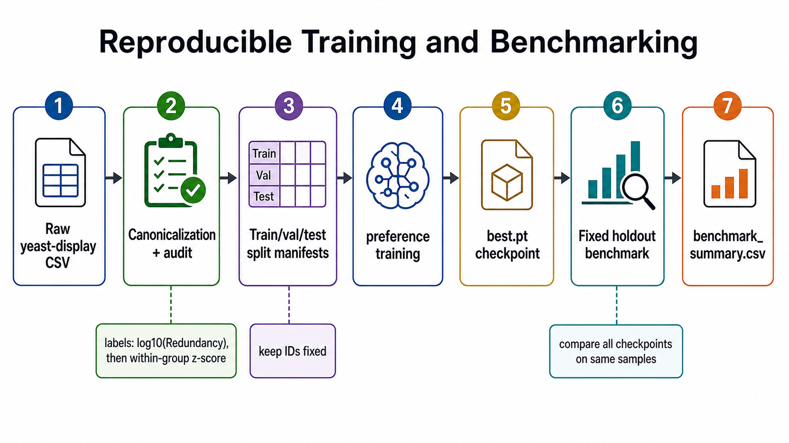
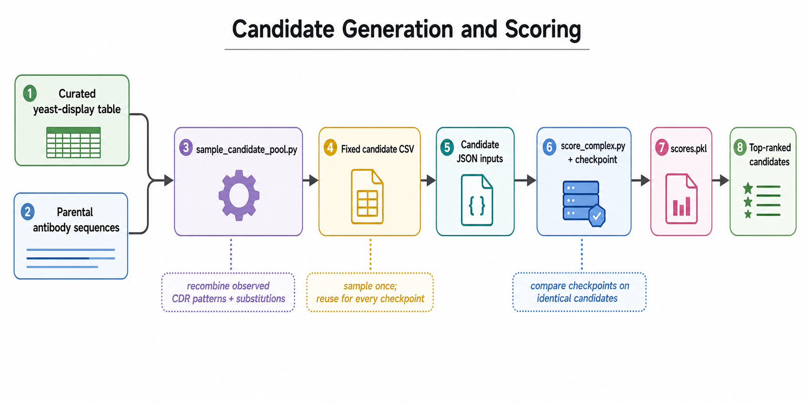

# AbAffMat (antibody affinity maturation)

AbAffMat aims to be an open-source reproduction and extension of AurekaBio's Aurabind architecture for *in silico* antibody affinity maturation.

The original Aurabind inference framework was obtained from [github.com/AurekaBio/Aureka-AIntibody-Challenges](https://github.com/AurekaBio/Aureka-AIntibody-Challenges).

Aurabind uses the Pairformer module from [Protenix](https://github.com/bytedance/Protenix) as an encoder trunk to generate structure- and sequence-aware representations of a protein-protein interaction (here, an antibody-antigen complex), then applies a scoring head that compresses those representations to a single binding-rank score.
The original Aurabind code included two scoring heads: a gated-pooling head with lightweight MLPs (now `GatedPoolingHead`, previously `AffinityHead`) and a head with an additional Pairformer refinement module (now `PairformerRefinementHead`, previously `BinderHead`).

## Model Architecture


AbAffMat scores antibody-antigen complexes from antigen, heavy-chain, and light-chain sequences. Yeast-display NGS enrichment is converted into preference pairs for scoring-head fine-tuning.

AurekaBio used this architecture to produce predictions for the AIntibody Challenges ([www.aintibody.org/the-challenges/](https://www.aintibody.org/the-challenges/)).
Challenge 1 is an *in silico* antibody affinity maturation task aimed at designing antibody CDRs with improved affinity for the RBD of SARS-CoV-2 and favorable developability properties, based on NGS datasets of the sorting outputs of an affinity maturation campaign with diversity in LCDR1-2, LCDR3 and HCDR1-2, as described by [Teixeira et al. 2022](https://www.aintibody.org/wp-content/uploads/2024/10/Simultaneous-affinity-maturation-and-developability-enhancement-using-natural-liability-free-CDRs.pdf).

The AIntibody Challenge 1 CSV used here was obtained from [github.com/alexstj0hn/AIntibody](https://github.com/alexstj0hn/AIntibody/blob/main/data/AIntibody_COMPETITION_1.csv).
This is not the official AIntibody Challenge data source, and the CSV has not yet been verified against the official competition data expected with publication of the competition results. Until that comparison is complete, please treat these data and any derived checkpoints or benchmarks as provisional.
The redundancy of paired heavy- and light-chain sequences in the sorted population approximates post-selection enrichment, which is expected to correlate, albeit noisily, with affinity to the antigen (here, SARS-CoV-2 RBD).

Major changes relative to the original Aurabind codebase include:

- Added local and Colab-ready inference flows for scoring antibody/antigen complexes, including `prepare_scoring_inputs.py`, `score_candidates.sh`, and the `runners/score_complex.py` scoring runner.
- Added yeast-display preprocessing and canonicalization with mixed IMGT/Kabat CDR handling, parental-sequence inference, mutation audits, resumable checkpoints, generated JSON scoring inputs, and train/validation/test split manifests.
- Added preference fine-tuning for yeast-display data, including reference-anchored DPO and pairwise-logistic ranking objectives, optional teacher/warm-start checkpoints, gradient accumulation, grouped validation metrics, and configurable per-group pair caps.
- Added candidate-pool generation for affinity maturation by recombining observed CDR patterns and frequent substitutions from curated yeast-display data.
- Added held-out benchmarking for comparing checkpoints on the same yeast-display samples, with score tables, winner-rank outputs, summary metrics, and optional W&B logging.
- Refactored scoring model components into configurable scoring heads and model-name utilities, while removing generated Python cache artifacts from version control.
- Added focused tests for yeast-display preprocessing, preference losses, candidate-pool sampling, training argument handling, scoring-head selection, and benchmarking.
- Added workflows for benchmarking new checkpoints against the original Aureka Aurabind checkpoint and AbAffMat fine-tuned checkpoints on the same held-out samples.

AbAffMat provides workflows for:

- in silico antibody affinity maturation,
- candidate-pool scoring, and
- preference fine-tuning on yeast-display affinity data.

## Table of Contents

- [Model Architecture](#model-architecture)
- [Open Model Development](#open-model-development)
- [License And Data Provenance](#license-and-data-provenance)
- [Public Checkpoints](#public-checkpoints)
- [Reproducibility Protocol](#reproducibility-protocol)
- [Run Example Inference On Local Environment](#run-example-inference-on-local-environment)
- [Run Example Inference On Google Colab](#run-example-inference-on-google-colab)
- [Fine-Tuning Of Scoring Head On Yeast-Display Preference Data](#fine-tuning-of-scoring-head-on-yeast-display-preference-data)
  - [1. Confirm antibody numbering dependencies](#1-confirm-antibody-numbering-dependencies)
  - [2. Prep Data: Preprocess yeast-display data](#2-prep-data-preprocess-yeast-display-data)
  - [3. Training: Run preference fine-tuning](#3-training-run-preference-fine-tuning)
  - [4. Evaluate models: Run benchmark metrics on same test set](#4-evaluate-models-run-benchmark-metrics-on-same-test-set-compare-modelscheckpoints)
  - [5. Generate samples: Construct antibody candidate pool](#5-generate-samples-construct-antibody-candidate-pool-to-score-with-models)
  - [6. Score samples: run inference on antibody candidate pool](#6-score-samples-run-inference-on-antibody-candidate-pool)

## Open Model Development

AurekaBio provides an Aurabind checkpoint with the original challenge repository, which serves as the upstream baseline for this project. AbAffMat builds on that starting point by adding yeast-display preprocessing, preference fine-tuning, candidate-pool generation, and checkpoint benchmarking workflows.

Two initial `GatedPoolingHead` checkpoints are being shared as AbAffMat baselines: a no-teacher pairwise-logistic run and a second pairwise-logistic run warm-started from that no-teacher checkpoint. These checkpoints should be treated as reproducible starting points for community iteration, not as final models.

Contributions are welcome, especially improvements to data curation, scoring heads, preference objectives, validation protocols, candidate-generation strategies, and benchmark comparisons against both the original Aureka checkpoint and AbAffMat-trained checkpoints. For useful comparisons, please keep the holdout manifest fixed, report the exact checkpoint path or release tag, and include the generated `benchmark_summary.csv`.

## License And Data Provenance

AbAffMat-specific code and documentation are released under the Apache License 2.0 unless otherwise noted. The original AurekaBio Aurabind/AIntibody Challenges codebase is MIT-licensed, and Protenix/OpenFold-derived components retain their upstream Apache-2.0 notices. See `LICENSE` and `THIRD_PARTY_NOTICES.md` for details.

Released AbAffMat checkpoint bundles are also intended to be shared under Apache-2.0, with the research-use caveats described in their model cards and release notes. The checkpoint scores are relative ranking outputs and should not be treated as calibrated affinity measurements or clinical, diagnostic, or therapeutic decision outputs.

The raw AIntibody Challenge 1 CSV and derived canonical data artifacts have third-party provenance. This repository does not grant additional rights to those data; users are responsible for confirming that their intended use is permitted.

## Public Checkpoints

Checkpoint files are not committed to git. Public checkpoints should be shared as release assets or external model artifacts together with their training config, split manifests, benchmark summary, and SHA256 checksum.

| Checkpoint | Status | File size | Scoring head | Training setup | Benchmark | Download |
|---|---|---:|---|---|---|---|
| `Covid-design-10.pt` | Upstream baseline | 632 MB | Aurabind/Aureka | Original Aureka challenge checkpoint | Included in provisional warm-start benchmark; protocol needs review | [Zenodo](https://zenodo.org/records/17784985/files/Covid-design-10.pt?download=1) |
| `abaffmat-gated-pooling-pairwise-logistic-no-teacher-v0.1` | Baseline | 203 MiB | `GatedPoolingHead` | No-teacher pairwise-logistic training on canonical yeast-display preference pairs | No benchmark bundled; use as reproducible baseline | [GitHub Release](https://github.com/eamonbyrne/abaffmat/releases/tag/abaffmat-gated-pooling-pairwise-logistic-no-teacher-v0.1) |
| `abaffmat-gated-pooling-pairwise-logistic-warm-start-v0.1` | Provisional | 203 MiB | `GatedPoolingHead` | Pairwise-logistic training warm-started from the no-teacher checkpoint | Provisional 600-sequence benchmark bundled; not final model performance | [GitHub Release](https://github.com/eamonbyrne/abaffmat/releases/tag/abaffmat-gated-pooling-pairwise-logistic-warm-start-v0.1) |
| `abaffmat-pairformer-refine-pairwise-logistic-v0.1` | Example community slot | TBD | `PairformerRefinementHead` | Contributor-submitted pairwise-logistic or ablation run | Pending reproducible benchmark | TBD |

Each AbAffMat checkpoint release should include `best.pt`, `config.yaml`, `train_command.sh`, logs, `checkpoint_manifest.json`, `MODEL_CARD.md`, `RELEASE_NOTES.md`, and `SHA256SUMS.txt`. The warm-start release also includes provisional benchmark artifacts.

## Reproducibility Protocol



For a comparable run, start from a clean clone, install the package in editable mode, download the upstream Aureka checkpoint to `outputs/Covid-design-10.pt`, preprocess the yeast-display CSV into a canonical table, train with a fixed seed, and benchmark every checkpoint on the same holdout ID file.

Published data releases can be downloaded and checksum-verified with:

```bash
bash scripts/download_aintibody_raw_data.sh
bash scripts/download_aintibody_canonical_data.sh
```

The raw release is used when rerunning preprocessing from `AIntibody_COMPETITION_1.csv`; the canonical release is used when you want to skip preprocessing and train or benchmark directly from the released processed files.

The main artifacts to preserve or share are:

- `outputs/yeast_display_canonical.csv`
- `outputs/yeast_display_canonical_train_ids.txt`
- `outputs/yeast_display_canonical_val_ids.txt`
- `outputs/yeast_display_canonical_test_ids.txt`
- `outputs/yeast-display-dpo_YYYYMMDD_HHMMSS/checkpoints/best.pt`
- `outputs/yeast-display-dpo_YYYYMMDD_HHMMSS/config.yaml`
- `outputs/yeast-display-dpo_YYYYMMDD_HHMMSS/train_dpo.log`
- `outputs/yeast_display_benchmark/benchmark_summary.csv`
- `checkpoint_manifest.json`, `MODEL_CARD.md`, `RELEASE_NOTES.md`, and `SHA256SUMS.txt` for any public checkpoint bundle

If you use the canonical data release directly, the equivalent fixed artifacts are under `data/AIntibody/COMP1_canonical/`.

The preference-training and Colab examples below use `seed=2025`, `split_seed=42`, the default `gated_pooling` scoring head, and `protenix_mini_default_v0.5.0` for memory-friendly runs unless otherwise noted.

## Run Example Inference On Local Environment
### 🛠 Installation

The examples below assume you are running commands from the repository root because they use the bundled scripts and sample data paths.

```bash
git clone https://github.com/eamonbyrne/abaffmat.git
cd abaffmat
conda create --name abaffmat python=3.11
conda activate abaffmat
python -m pip install -e .
```

Use a CUDA-capable GPU for practical scoring or fine-tuning runs. The package requires Python 3.11 and PyTorch 2.0 or newer. If your CUDA/PyTorch build needs a platform-specific wheel, install that first from the official PyTorch instructions, then run `python -m pip install -e .`.

Confirm the install and the data utilities before launching GPU jobs. Install `pytest` first if it is not already available in your environment:

```bash
python -m pip install pytest
python -m pytest tests/test_dpo_loss.py tests/test_yeast_display.py tests/test_candidate_pool.py
```

### 📥 Download

Download the example [Aureka/Aurabind](https://github.com/AurekaBio/Aureka-AIntibody-Challenges) checkpoint:

```bash
mkdir -p outputs
wget "https://zenodo.org/records/17784985/files/Covid-design-10.pt?download=1" -O outputs/Covid-design-10.pt
```

This checkpoint is used both as an inference example and as the upstream baseline for benchmark comparisons.

### 🚀 Inference

```bash
conda activate abaffmat
bash predict.sh
```

To score a different candidate pool CSV, pass it on the command line:

```bash
bash predict.sh outputs/h1_h2_candidate_pool.csv
```

`predict.sh` is a thin alias for `score_candidates.sh`. The optional second argument overrides the intermediate JSON directory used by `runners/score_complex.py`. For reproducible comparisons, score all candidates for a given comparison in one run and keep the generated `scores.pkl` with the exact input CSV.

After running the scoring command, an output directory named `./outputs/Covid-design_YYYYMMDD_HHMMSS/` (with timestamp in `YYYYMMDD_HHMMSS` format) will be generated automatically. The complex scores are stored in `./outputs/Covid-design_YYYYMMDD_HHMMSS/scores/scores.pkl`.

The 10 sequences with the highest scores in this `.pkl` file are the top-ranked designed candidates.

## ☁️ Run Example Inference On Google Colab

Use a GPU runtime in Colab before running the cells below:
`Runtime -> Change runtime type -> GPU`

### 🛠 Installation

```python
!git clone https://github.com/eamonbyrne/abaffmat.git
%cd /content/abaffmat

!pip install -q -e .
```

### 📥 Download

Download the example [Aureka/Aurabind](https://github.com/AurekaBio/Aureka-AIntibody-Challenges) checkpoint:

```python
!mkdir -p outputs
!wget "https://zenodo.org/records/17784985/files/Covid-design-10.pt?download=1" -O outputs/Covid-design-10.pt
```

### 🚀 Inference

Use the non-ESM mini checkpoint on standard Colab. The ESM-backed model loads the 3B ESM encoder during preprocessing and will usually be killed for memory usage on free or lower-memory Colab runtimes.

```python
%%bash
python prepare_scoring_inputs.py --input_csv_path "./data/Covid/Aurabind_Covid_design_inference_samples.csv" --output_dir "./data/Covid/Aurabind_Covid_design_inference_samples"

WANDB_MODE=offline CUDA_VISIBLE_DEVICES=0 PYTHONPATH=. TRIANGLE_MULTIPLICATIVE=torch \
torchrun --standalone --nproc_per_node=1 runners/score_complex.py \
  --project "Covid-design" \
  --run_name "Covid-design" \
  --base_dir "./outputs" \
  --model_name "protenix_mini_default_v0.5.0" \
  --deterministic_seed True \
  --seed "2025" \
  --dtype "fp32" \
  --max_steps "200" \
  --eval_interval "1" \
  --checkpoint_interval "1" \
  --log_interval "1" \
  --iters_to_accumulate "1" \
  --precompute_esm "False" \
  --num_workers "0" \
  --score_input_json_path "./data/Covid/Aurabind_Covid_design_inference_samples" \
  --lr "1e-4" \
  --batchsize "1" \
  --load_params_only "True" \
  --skip_load_optimizer "True" \
  --skip_load_step "True"
```

If you are on a higher-memory runtime and specifically want the ESM-backed model, switch `--model_name` to `protenix_mini_esm_v0.5.0` and set `--precompute_esm "True"`.

### 🎯 Outputs
Find the output file:

```python
import glob
latest_run = sorted(glob.glob("outputs/Covid-design_*"))[-1]
print(f"{latest_run}/scores/scores.pkl")
```

If you want to download the prediction file directly from Colab:

```python
from google.colab import files
files.download(f"{latest_run}/scores/scores.pkl")
```

## Fine-Tuning Of Scoring Head On Yeast-Display Preference Data

Yeast-display enrichment data are naturally comparative: within a sorted library, sequences observed at higher abundance are treated as preferred over lower-abundance alternatives, but the counts are noisy and not calibrated affinity measurements. Pairwise preference learning is a practical fit for this setting because it trains the scoring head to rank enriched antibody-antigen complexes above less-enriched complexes without requiring absolute binding labels. Since the Pairformer trunk already represents the heavy chain, light chain, and antigen as a structured interaction, fine-tuning only the lightweight scoring head provides a conservative way to adapt the model to assay-derived binding preferences while limiting the risk of overfitting the full structure-based module.

### 1. Confirm antibody numbering dependencies

The editable install above includes `abnumber` and `anarci`. If you are using an older environment, install them before preprocessing:

```bash
python -m pip install -q abnumber anarci
```

### 2. Prep Data: Preprocess yeast-display data

The bundled `data/Covid/mock_affinity_maturation_yeast_display_ngs.csv` is a small example that exercises the workflow. For a real reproduction attempt, either download the released raw CSV and rerun preprocessing, or download the released canonical data and skip this preprocessing step:

```bash
# Raw CSV for rerunning preprocessing:
bash scripts/download_aintibody_raw_data.sh

# Canonical CSV, rejected-row audit, and fixed split manifests:
bash scripts/download_aintibody_canonical_data.sh
```

These scripts download GitHub Release assets and verify their SHA256 checksums. The raw CSV is written to `data/AIntibody/AIntibody_COMPETITION_1.csv`; the canonical release is written to `data/AIntibody/COMP1_canonical/`.

The yeast-display preprocessing expects mixed antibody numbering schemes:

- `cdr1_aa_heavy`, `cdr2_aa_heavy`, `cdr3_aa_heavy`, `cdr1_aa_light`, and `cdr3_aa_light` are interpreted with IMGT numbering; `cdr2_aa_light` is interpreted with Kabat numbering, matching the [AIntibody Challenges](https://www.aintibody.org/the-challenges/) format outline.
- If all CDR columns for a chain are populated, preprocessing treats those CDRs as the authoritative segmentation and checks that they align back to the full sequence. If any CDRs are blank, preprocessing falls back to AbNumber/ANARCI inference for that chain. Placeholder or approximate CDR annotations should be left blank.
- By default, rows are curated as fixed-parental-framework library members: framework mutations and CDR changes outside the CDRs listed in `sort_population` are rejected. For broader model-training data, pass `--allow_offtarget_framework_mutations` and/or `--allow_offtarget_cdr_mutations`.

Yeast-display labels are derived from post-selection NGS abundance: the raw `Redundancy` count is converted to `label_raw = log10(Redundancy)`, then standardized within each library/round/antigen group as `label_std`; larger labels indicate variants enriched by the sort and are treated as preferred binders for pair construction.

Prepare an enriched canonical table plus JSON samples:

```bash
python prepare_yeast_display_data.py \
  --raw_yeast_csv_path data/AIntibody/AIntibody_COMPETITION_1.csv \
  --canonical_output_path outputs/yeast_display_canonical.csv \
  --json_output_dir outputs/yeast_display_json \
  --audit_output_path outputs/yeast_display_rejected.csv \
  --antigen_name covid19_rbd \
  --antigen_sequence "<RBD_SEQUENCE>" \
  --experimental_round round1
```

Replace `<RBD_SEQUENCE>` with the SARS-CoV-2 RBD sequence used for the dataset/release being reproduced. Keep this antigen sequence fixed across preprocessing, training, benchmarking, and candidate-pool scoring.

By default, `prepare_yeast_display_data.py` reads the parental heavy/light sequences from
the row whose `sort_population` is `parental` and excludes that non-observation row from
the curated output. If your input CSV does not include that row, provide
`--parental_heavy_sequence` and `--parental_light_sequence` explicitly. The emitted
`parental_id` defaults to `parental` and can be overridden with `--parental_id`.

For large CSVs, add a resumable preprocessing state checkpoint:

```bash
  --canonicalization_checkpoint_interval "1000" \
  --canonicalization_state_path "outputs/yeast_display_canonical_state.pkl"
```

If the run is interrupted, rerun the same command with the same state path to resume
from the next unprocessed row. If `--canonicalization_checkpoint_interval` is set
without `--canonicalization_state_path`, the state file defaults to the canonical output
path with `.canonicalization_state.pkl` as the suffix.

This writes:

- `outputs/yeast_display_canonical.csv`
- `outputs/yeast_display_json/`
- `outputs/yeast_display_canonical_train_ids.txt`
- `outputs/yeast_display_canonical_val_ids.txt`
- `outputs/yeast_display_canonical_test_ids.txt`
- `outputs/yeast_display_rejected.csv`

Before training, inspect the curation and split sizes:

```bash
python - <<'PY'
import pandas as pd

df = pd.read_csv("outputs/yeast_display_canonical.csv")
print(df.groupby(["library_name", "split"]).size())
print(df[["label_raw", "label_std", "redundancy"]].describe())

rejected = pd.read_csv("outputs/yeast_display_rejected.csv")
print(f"accepted={len(df)} rejected={len(rejected)}")
PY
```

By default, splits are assigned per sample while stratifying within each library, which keeps
train/validation/test counts close to `1 - val_fraction - test_fraction`,
`val_fraction`, and `test_fraction` even when library sizes are very different. To hold out
whole libraries instead, pass `--split_strategy library`; this is stricter but can be
highly imbalanced when there are only a few libraries. For fair benchmarking, inspect the
rejected-row audit and the split counts before training. If the released dataset ships an
official holdout, pass those manifests into training/benchmarking instead of relying on the
generated split.

The yeast-display data are used as training data to fine-tune the scoring head with pairwise preference objectives (Step 3). They are also used as an example set to combinatorially generate novel candidate antibodies (Step 5).

### 3. Training: Run preference fine-tuning

Run "no-teacher" (i.e. no pre-existing checkpoint) preference fine-tuning of the scoring head for the primary benchmark:

```bash
WANDB_MODE=offline CUDA_VISIBLE_DEVICES=0 PYTHONPATH=. TRIANGLE_MULTIPLICATIVE=torch \
torchrun --standalone --nproc_per_node=1 runners/train_dpo.py \
  --project "yeast-display-dpo" \
  --run_name "yeast-display-dpo" \
  --base_dir "./outputs" \
  --model_name "protenix_mini_default_v0.5.0" \
  --canonical_output_path "outputs/yeast_display_canonical.csv" \
  --deterministic_seed "True" \
  --seed "2025" \
  --dtype "fp32" \
  --max_steps "150" \
  --eval_interval "5" \
  --max_eval_batches "16" \
  --checkpoint_interval "10" \
  --log_interval "5" \
  --batchsize "2" \
  --num_workers "0" \
  --preference_gap "0.5" \
  --max_pairs_per_group "128" \
  --eval_first "True" \
  --dpo_beta "0.1"
```

Preference training reads samples directly from `--canonical_output_path`; pre-generated
per-sample JSON files are not required. If `--json_output_dir` is provided, the
legacy JSON-directory loader is used instead.

If you downloaded the canonical data release instead of rerunning preprocessing, set:

```bash
  --canonical_output_path "data/AIntibody/COMP1_canonical/yeast_display_COMP1_canonical.csv"
```

The command writes a timestamped run directory under `outputs/yeast-display-dpo_YYYYMMDD_HHMMSS/`. Preserve `config.yaml`, `checkpoints/best.pt`, `train_dpo.log`, and the exact training command when sharing a checkpoint or opening a comparison issue. Public releases should also include a model card, release notes, a manifest, and SHA256 checksums.

The public v0.1 checkpoint bundles are the authoritative reproduction record for
the shared runs. Use their bundled `train_command.sh`, `config.yaml`, and
`checkpoint_manifest.json` when trying to reproduce those exact checkpoints.

For more stable preference-training updates on memory-limited GPUs, use gradient accumulation and
the optimizer knobs exposed by the base config:

```bash
  --batchsize "2" \
  --iters_to_accumulate "4" \
  --grad_clip_norm "1.0" \
  --adam.use_adamw "True" \
  --adam.weight_decay "1e-6" \
  --eval_first "True"
```

With `--batchsize 2 --iters_to_accumulate 4`, the effective batch size is 8
preference pairs while only 2 pairs are held in memory at once.

To cap pair counts differently across preference groups, add
`--max_pairs_per_group_by_key` with comma-separated overrides. Keys may be either
`library_name` alone or the full `library_name|experimental_round|antigen_name`
group key. Example:

```bash
  --max_pairs_per_group "2048" \
  --max_pairs_per_group_by_key "phase1_l1_l2_am=4096,phase1_h1_h2_am=1024,phase1_l3_am=1024"
```

Validation logs include:

- `VAL_MICRO` for the pooled validation subset
- `VAL_MACRO` for the unweighted average across preference groups
- one `VAL_GROUP` line per preference group, using the full
  `library_name|experimental_round|antigen_name` key

This makes it easier to see whether aggregate gains are coming from only one subset
of the training distribution.

The default preference objective is reference-anchored DPO:

```bash
  --dpo_loss_type "anchored_dpo"
```

`anchored_dpo` optimizes the model to prefer enriched sequences over less-enriched
sequences while anchoring those preferences to the score margins from a frozen
reference model.

For direct ranking training without reference-model margins, use:

```bash
  --dpo_loss_type "pairwise_logistic" \
  --dpo_beta "1.0"
```

`pairwise_logistic` optimizes `score(chosen) > score(rejected)` directly and skips
reference-model forward passes during training/evaluation.

The first two public AbAffMat checkpoint bundles use `pairwise_logistic` with the
`GatedPoolingHead`: `abaffmat-gated-pooling-pairwise-logistic-no-teacher-v0.1`
starts from the base mini model, while
`abaffmat-gated-pooling-pairwise-logistic-warm-start-v0.1` starts from the
no-teacher checkpoint.

For quick smoke tests, keep `--max_eval_batches` small or set `--eval_interval -1`
to skip validation. Full validation can be slow because each preference pair requires
separate chosen/rejected feature generation, plus reference-model forward passes for
`--dpo_loss_type "anchored_dpo"`.

To track a run with Weights & Biases, log in once with `wandb login`, remove
`WANDB_MODE=offline` from the command, and add:

```bash
  --use_wandb "True" \
  --project "yeast-display-dpo" \
  --run_name "yeast-display-dpo"
```

If you prefer offline tracking in Colab, keep `WANDB_MODE=offline` and sync later with
`wandb sync outputs/<run_name>/wandb/offline-run-*`.

This is the default no-teacher setup:

- both `--load_checkpoint_path` and `--reference_checkpoint_path` are omitted
- the policy starts from the base `protenix_mini_default_v0.5.0` backbone
- no external teacher checkpoint is used
- with `--dpo_loss_type "anchored_dpo"`, the frozen reference is a copy of the initial policy
- with `--dpo_loss_type "pairwise_logistic"`, no reference-model margins are used
- `best.pt` is selected by validation `pair_accuracy`

The scoring head is also configurable:

- `--model.scoring_head_name "gated_pooling"` selects the default gated pooling head (formerly `AffinityHead`)
- `--model.scoring_head_name "pairformer_refine"` selects the extra Pairformer refinement head (formerly `BinderHead`)

To train the Pairformer refinement head instead, add this argument to the main training command:

```bash
  --model.scoring_head_name "pairformer_refine"
```

If you want a teacher-anchored ablation instead, add:

```bash
  --reference_checkpoint_path "outputs/Covid-design-10.pt"
```

If you want a warm-start ablation from the upstream Aureka checkpoint, add:

```bash
  --reference_checkpoint_path "outputs/Covid-design-10.pt" \
  --load_checkpoint_path "outputs/Covid-design-10.pt"
```

The public warm-start checkpoint instead uses the no-teacher AbAffMat checkpoint
as `--load_checkpoint_path` and keeps `--reference_checkpoint_path "None"`.

Use a short smoke test only to validate data loading and pair counts by changing the main training command to:

```bash
  --max_steps "20" \
  --eval_interval "5" \
  --checkpoint_interval "10" \
  --max_eval_batches "4"
```

Then run the real comparison with validation-driven checkpoint selection.

### 4. Evaluate models: Run benchmark metrics on same test set (compare models/checkpoints)

Benchmark any held-out manifest (e.g. test set or novel candidate pool) on the exact same samples for every checkpoint:

```bash
WANDB_MODE=offline CUDA_VISIBLE_DEVICES=0 PYTHONPATH=. TRIANGLE_MULTIPLICATIVE=torch \
python benchmark_yeast_display.py \
  --canonical_output_path outputs/yeast_display_canonical.csv \
  --holdout_ids_path outputs/yeast_display_canonical_test_ids.txt \
  --checkpoint_paths \
    outputs/Covid-design-10.pt \
    outputs/yeast-display-dpo_YYYYMMDD_HHMMSS/checkpoints/best.pt \
  --output_dir outputs/yeast_display_benchmark \
  --ranking_label_column label_raw \
  --preference_gap 0.5 \
  --top_ks 1,5,10,20 \
  --winner_count 10
```

If you downloaded the canonical data release, replace the benchmark input paths with:

```bash
  --canonical_output_path data/AIntibody/COMP1_canonical/yeast_display_COMP1_canonical.csv \
  --holdout_ids_path data/AIntibody/COMP1_canonical/yeast_display_COMP1_canonical_test_ids.txt
```

Per checkpoint, the benchmark writes:

- `benchmark/heldout_scores.csv`
- `benchmark/winner_ranks.csv`
- `benchmark/summary.json`

The combined table is written to `outputs/yeast_display_benchmark/benchmark_summary.csv`.
By default, the benchmark generates scoring JSON inputs for the held-out samples
from the canonical table under `outputs/yeast_display_benchmark/canonical_holdout_json`.
If you already have per-sample JSON files, pass `--json_output_dir outputs/yeast_display_json`
to reuse them instead.
To log the benchmark comparison to Weights & Biases, add:

```bash
  --use_wandb "True" \
  --project "yeast-display-benchmark" \
  --run_prefix "yeast-display-benchmark"
```

The W&B run logs one scalar step per checkpoint plus a final `benchmark/summary_table`.

Recommended benchmark order:

1. Score the locked holdout zero-shot with `Covid-design-10.pt`.
2. Train from the base mini model in the no-teacher setup above, then benchmark `best.pt` on the same holdout.
3. Optionally run the warm-start continuation from the no-teacher checkpoint and benchmark it on the same holdout.
4. Optionally run teacher-anchored ablations against `Covid-design-10.pt` and benchmark them on the same holdout.

When reporting results, include `outputs/yeast_display_benchmark/benchmark_summary.csv`, the exact `holdout_ids_path`, the checkpoint filenames, and whether `ranking_label_column` was `label_raw` or `label_std`.

The bundled benchmark in `abaffmat-gated-pooling-pairwise-logistic-warm-start-v0.1`
uses a runtime-limited 600-sequence holdout subset with a 300/150/150 split across
`phase1_l1_l2_am`, `phase1_h1_h2_am`, and `phase1_l3_am`. Both the upstream
`Covid-design-10.pt` checkpoint and the warm-start AbAffMat checkpoint performed
poorly in that provisional comparison, so treat those results as a benchmark
protocol smoke test rather than a final estimate of model quality.

### 5. Generate samples: Construct antibody candidate pool (to score with model/s)



The original Aurabind repository included a fixed set of 10,000 COVID design sequences for inference. In this repo, that file is available at `data/Covid/Aurabind_Covid_design_inference_samples.csv` and can be used as a shared candidate pool for reproducing the upstream example or comparing checkpoints on the same designs.

Sample an Aurabind-style candidate pool for a design task by fixing the parental framework/non-target CDRs and recombining observed CDR patterns plus frequent single-site substitutions from the curated table:

```bash
python sample_candidate_pool.py \
  --canonical_input_path outputs/yeast_display_canonical.csv \
  --output_path outputs/h1_h2_candidate_pool.csv \
  --json_output_dir outputs/h1_h2_candidate_json \
  --parental_heavy_sequence "<PARENT_HEAVY>" \
  --parental_light_sequence "<PARENT_LIGHT>" \
  --target_cdrs H1,H2 \
  --n_samples 10000 \
  --seed 2025
```

Replace `<PARENT_HEAVY>` and `<PARENT_LIGHT>` with the parental antibody sequences used during preprocessing. For benchmarking checkpoints/models (Step 4), either use the bundled Aurabind 10,000-sequence pool or sample one candidate pool *once* and score that fixed pool with every checkpoint. Do not regenerate a different pool per model.

If you downloaded the canonical data release, use `--canonical_input_path data/AIntibody/COMP1_canonical/yeast_display_COMP1_canonical.csv` when sampling a new candidate pool.

### 6. Score samples: run inference on antibody candidate pool

Generate "affinity-style" ranking scores on antibody light-chain/heavy-chain and antigen complexes for all antibodies in the candidate pool. Top-scored candidates are expected to be stronger binders for this antigen.

`prepare_scoring_inputs.py` is not necessary here because `sample_candidate_pool.py` directly generates sample input JSON files.

```bash
WANDB_MODE=offline CUDA_VISIBLE_DEVICES=0 PYTHONPATH=. TRIANGLE_MULTIPLICATIVE=torch \
torchrun --standalone --nproc_per_node=1 runners/score_complex.py \
  --project "yeast-display-dpo" \
  --run_name "yeast-display-dpo" \
  --base_dir "./outputs" \
  --model_name "protenix_mini_default_v0.5.0" \
  --load_checkpoint_path "outputs/yeast-display-dpo_YYYYMMDD_HHMMSS/checkpoints/best.pt" \
  --deterministic_seed True \
  --seed "2025" \
  --dtype "fp32" \
  --precompute_esm "False" \
  --num_workers "4" \
  --score_input_json_path "./outputs/h1_h2_candidate_json" \
  --max_samples "100" \
  --batchsize "1" \
  --load_params_only "True" \
  --skip_load_optimizer "True" \
  --skip_load_step "True"
```

You can increase `--max_samples` as compute time allows. It is best to only compare scores between samples that have been scored in the same run. Therefore, to identify the best top-ranked candidates, run the largest number of samples you can in the same scoring run.

The scoring run writes `scores/scores.pkl` under a timestamped output directory. Keep that file together with the candidate CSV and checkpoint path so others can reproduce the candidate ranking.

## Citation

If you use AbAffMat code, checkpoints, data-processing scripts, or benchmark outputs, please cite this repository and the relevant upstream work. Citation metadata are provided in `CITATION.cff`.

Please also cite the original resources that AbAffMat builds on, including AurekaBio/Aurabind, Protenix, OpenFold where relevant, and the AIntibody Challenge / Teixeira et al. yeast-display dataset.